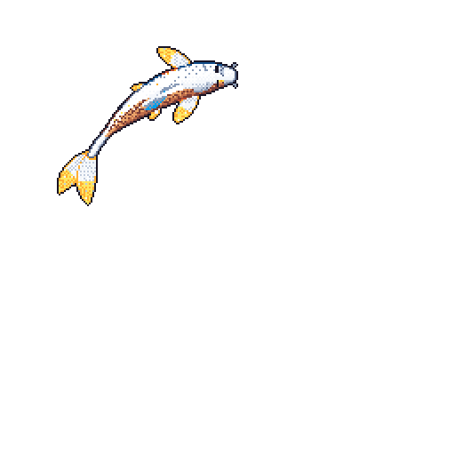

# Léo Souza

**Informatics Engineering student @ University of the Algarve (UAlg), graduating in 2027**
Looking for a **junior Java backend role from July 2027**

---

## 🔧 Selected work

| Project | What it is | Stack |
|---|---|---|
| **[FintList](https://github.com/kakurokan/FintList)** | Array-backed doubly linked list for `int` with slot reuse and last-access caching, benchmarked against a linked list with doubling-ratio tests. *Course project, built with a partner.* | Java, Maven, JUnit 5 |
| **[Maritime Navigation Simulator](https://github.com/kakurokan/Maritime_Navigation)** | Desktop simulator of maritime traffic using Strategy (Dijkstra routing), State and Memento patterns, with unit tests and CI. *Course project.* | Java, Swing, Maven, JUnit 5 |
| **[ENEI 2027 platform](https://github.com/Dep-tech-coenei-faro-27/event-site)** | Backend contributor on the ticketing platform for the national informatics students' event, hosted in Faro. *Team project.* | Python, FastAPI, PostgreSQL, Alembic, Docker, GitHub Actions |
| **[Non-linear & hashing data structures](https://github.com/kakurokan/non-linear_and_hashing_data_structures)** | Custom tree and multi-level hash table with empirical complexity analysis. *Course project, team of 3.* | Java, Maven |

## 🏁 Competitive programming

Representing UAlg in SWERC 2025, MIUP 2025 and MIUP 2026 (C++ and Java).
Team notebook: [SwercNotebookUALG](https://github.com/kakurokan/SwercNotebookUALG).

## 🌍 Languages

Portuguese (native) · English (professional)

---

Drawn nightly by <a href="https://github.com/yalongwastaken/git-koi">git-koi</a> from my public activity

